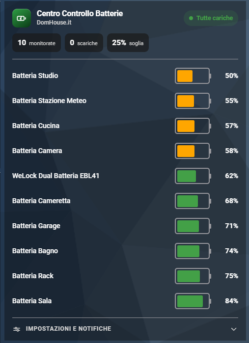

# Centro Controllo Batterie Home Assistant (Card)

[](https://github.com/SalvatoreITA/Centro-Controllo-Batterie-Card/blob/main/README_it.md)
[](https://github.com/SalvatoreITA/Centro-Controllo-Batterie-Card/blob/main/README.md)

[](https://github.com/hacs/integration)
[]()
[](https://www.domhouse.it)

## 📖 Descrizione

**Centro Controllo Batterie Card** è la card Lovelace pensata per l'integrazione
**[Centro Controllo Batterie](https://github.com/SalvatoreITA/Centro-Controllo-Batterie)**.
Mostra tutte le batterie monitorate con barre colorate per livello, lo stato
d'allarme e le scorciatoie alle notifiche.

Si **auto-configura**: scegli il dispositivo dell'integrazione e la card pesca da
sola batterie, soglia, interruttori e orari. Niente entità da mappare a mano.

## 📸 Anteprima



## ✨ Caratteristiche

- 🔌 **Zero configurazione**: basta scegliere il dispositivo, il resto è automatico.
- 🔋 **Barre batteria** che si riempiono in proporzione alla percentuale.
- 🎨 **Colori fissi per livello**: 🔴 1–30% · 🟠 31–60% · 🟢 61–100%.
- 🔢 **Riepilogo**: batterie monitorate, scariche, soglia + pill di stato.
- 📑 **Due layout**: **Lista** (compatta) e **Griglia** (grafica), con selettore opzionale.
- ⚙️ **Sezione a scomparsa** con slider soglia, interruttori Google/Alexa/Push e finestra oraria.
- 👆 Tocca una batteria per aprire la sua finestra **info**.
- 🖌️ **Editor grafico** e adattamento automatico al **tema** di Home Assistant (chiaro/scuro).

## ✅ Requisiti

- L'integrazione **[Centro Controllo Batterie](https://github.com/SalvatoreITA/Centro-Controllo-Batterie)** installata e configurata.

## 📦 Installazione

### Opzione A — HACS (consigliata)

1. In HACS apri **⋮ → Repository personalizzate**.
2. Incolla `https://github.com/SalvatoreITA/domhouse-battery-card`, categoria **Dashboard**, poi **Aggiungi**.
3. Installa **DomHouse Battery Card** e **ricarica la pagina**.

HACS aggiunge da solo la risorsa Lovelace.

### Opzione B — Manuale

1. Copia `domhouse-battery-card.js` in `config/www/`.
2. **Impostazioni → Dashboard → Risorse → Aggiungi risorsa**:
   - URL: `/local/domhouse-battery-card.js`
   - Tipo: **Modulo**
3. Ricarica la pagina (se non si aggiorna, **Ctrl+Shift+R** o aggiungi `?v=3` all'URL della risorsa).

## ⚙️ Uso

Aggiungi una card → cerca **DomHouse Battery Card** → nell'editor scegli il
**dispositivo** Centro Controllo Batterie. Fatto.

In YAML bastano due righe:

```yaml
type: custom:domhouse-battery-card
device: <id del dispositivo Centro Controllo Batterie>
```

Esempio con qualche opzione estetica:

```yaml
type: custom:domhouse-battery-card
device: a1b2c3d4e5f6…
title: Centro Controllo Batterie
layout: list          # list | grid
collapsible: true
collapsed: true
```

### Opzioni

| Opzione | Tipo | Default | Descrizione |
|---|---|---|---|
| `device` | string | — | **Dispositivo** dell'integrazione: da qui la card ricava tutto. |
| `title` / `subtitle` | string | Centro Controllo Batterie / DomHouse.it | Intestazione della card. |
| `layout` | string | `list` | Layout iniziale: `list` o `grid`. |
| `layout_toggle` | bool | `true` | Mostra il selettore Lista/Griglia. |
| `show_legend` | bool | `true` | Mostra la legenda dei colori. |
| `collapsible` | bool | `true` | Sezione impostazioni/notifiche a scomparsa. |
| `collapsed` | bool | `true` | La sezione parte chiusa. |
| `accent` | string | `#2e9e44` | Colore accento (verde DomHouse). |

> **Uso avanzato / senza integrazione:** al posto di `device` puoi mappare le
> entità a mano con `entities:` (lista sensori batteria) ed eventualmente
> `threshold_entity`, `switch_google/alexa/push`, `time_start/time_end`,
> oppure `sensor:` (il sensore *batterie scariche* dell'integrazione).

## 🎨 Colori e livelli

I colori sono **fissi** e non configurabili, per una lettura immediata:

| Colore | Livello |
|:---:|---|
| 🔴 Rosso | 1 – 30% |
| 🟠 Arancione | 31 – 60% |
| 🟢 Verde | 61 – 100% |

> Lo **slider Soglia** nella sezione a scomparsa regola la soglia di **allarme**
> (usata dall'integrazione per le notifiche): è indipendente dai colori, che
> restano fissi.

## 🖼️ Tema

La card usa le variabili del tema di Home Assistant
(`--primary-text-color`, `--card-background-color`, `--divider-color`,
`--success/-warning/-error-color`), quindi segue automaticamente tema
chiaro/scuro e il tuo tema DomHouse. L'accento è forzabile con l'opzione
`accent` o la variabile `--domhouse-accent`.

## ❓ FAQ

<details>
<summary><b>Le batterie appaiono vuote / senza colore.</b></summary>

Quasi sempre è la cache dei moduli: ricarica con <b>Ctrl+Shift+R</b> o aggiungi
<code>?v=3</code> all'URL della risorsa. Verifica anche di avere l'integrazione
aggiornata (1.2.0+).
</details>

<details>
<summary><b>Non vedo nessuna batteria.</b></summary>

Controlla di aver scelto il <b>dispositivo</b> giusto nell'editor e che
nell'integrazione siano configurati dei sensori batteria.
</details>

<details>
<summary><b>Che nome mostra per ogni batteria?</b></summary>

Il <b>Nome</b> impostato sull'entità (senza il prefisso di stanza/device). Lo
gestisce l'integrazione.
</details>

<details>
<summary><b>Posso usarla senza l'integrazione?</b></summary>

Sì (uso avanzato): invece di <code>device</code> elenca i sensori batteria in
<code>entities:</code>. Vedi la nota nella sezione Opzioni.
</details>

## ☕ Supporta il Progetto

Ogni piccolo supporto fa un'enorme differenza: mi aiuta a mantenere vivo l'entusiasmo e mi stimola a creare e condividere nuove soluzioni per la community. Grazie di cuore per il tuo aiuto! 🚀

[](https://ko-fi.com/salvatore_dh)

## ❤️ Crediti
Sviluppato da [Salvatore Lentini - DomHouse.it](https://www.domhouse.it)
